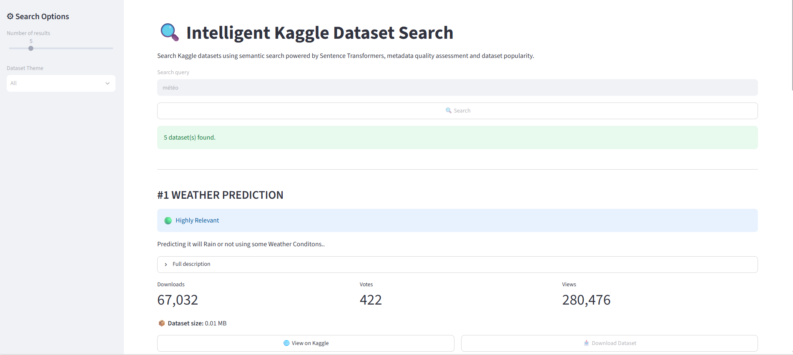
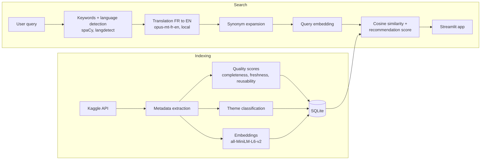

# Intelligent Metadata Management System for Kaggle Datasets

A search engine that helps find the right dataset on Kaggle. It combines **semantic search** (sentence embeddings), **metadata quality assessment** and **dataset popularity**, and accepts queries in **English and French**.

Final-year project (PFE) of the MSc Data Management at **aivancity** (2026), supervised by Dr Alexandre Kson.

**At a glance:** 1,064 Kaggle datasets indexed · queries in English and French, translated locally · evaluated on 15 queries against a BM25 baseline · adding dataset descriptions raises nDCG@5 from 0.857 to 0.896.



---

## The problem

Open data platforms host thousands of datasets, but finding a good one is hard:

- keyword search misses datasets described with other words (*weather* vs. *meteorology*);
- many datasets are poorly documented (no description, no license, outdated);
- users do not always search in English.

This project indexes the metadata of 1,064 Kaggle datasets and ranks them for a query by **relevance**, **metadata quality** and **popularity**.

## How it works



**Indexing.** For each dataset, the title, subtitle, tags and description are encoded with the SentenceTransformer model `all-MiniLM-L6-v2`, which produces **384-dimensional** embeddings. The text order is title, subtitle, tags, then description: the model reads about 256 tokens, so the long description is the part that gets truncated.

**Metadata quality** (`src/profiling/metadata_profiler.py`), inspired by ISO/IEC 25012:

| Score | What it measures | Weight in the metadata score |
|---|---|---|
| Completeness | presence and length of title, description, tags, license, creator… | 0.4 |
| Freshness | time since last update (exponential decay, 5-year half-life) | 0.3 |
| Reusability | license openness (CC0, MIT… score higher), description, creator, tags | 0.3 |

**Search.** The query is cleaned and lemmatized, French queries are translated to English with a **local** MarianMT model (no external service), and keywords are expanded with a synonym dictionary. Datasets are then ranked by:

```
recommendation score = 0.5 × search score + 0.3 × metadata score + 0.2 × popularity score
```

where the search score is the cosine similarity, and the popularity score combines downloads, votes and views (log scale, normalized between 0 and 1). Results below a similarity of 0.15, or that contain none of the query keywords, are filtered out.

## Evaluation

The search engine was evaluated on **15 queries** (8 English, 7 French), comparing four systems:

| System | Description |
|---|---|
| `bm25` | Keyword search (BM25) on title, subtitle, tags and description |
| `embeddings_v1` | Cosine similarity, embeddings of title and tags only (the PFE version, when descriptions were not collected) |
| `embeddings_v2` | Cosine similarity, embeddings of title, subtitle, tags and description |
| `combined_v2` | Full app ranking: similarity threshold, keyword filter and recommendation score |

All systems use the same query processing (translation and synonyms). The top 5 results of all systems were pooled, shuffled and graded without knowing which system returned them: **2** = relevant, **1** = partially relevant, **0** = not relevant.

### Results

All 15 queries:

| System | P@5 | MRR@5 | nDCG@5 |
|---|---|---|---|
| bm25 | 0.933 | 1.000 | 0.871 |
| embeddings_v1 | 0.960 | 1.000 | 0.857 |
| embeddings_v2 | 0.960 | 1.000 | **0.896** |
| combined_v2 | 0.933 | 0.967 | 0.867 |

French queries (7):

| System | P@5 | MRR@5 | nDCG@5 |
|---|---|---|---|
| bm25 | 0.943 | 1.000 | 0.818 |
| embeddings_v1 | 0.943 | 1.000 | 0.752 |
| embeddings_v2 | 0.971 | 1.000 | **0.840** |
| combined_v2 | 0.914 | 0.929 | 0.814 |

P@5 and MRR@5 count a result as relevant when its grade is ≥ 1; nDCG@5 uses the grades 0 / 1 / 2. Per-query results are in [`evaluation/results.csv`](evaluation/results.csv).

### Findings

- **Descriptions improve the ranking.** Adding descriptions to the embeddings raises nDCG@5 from 0.857 to 0.896 (better on 7 queries, worse on 2, equal on 6), and from 0.752 to 0.840 on French queries.
- **The combined score does not improve relevance.** It ranks slightly below embeddings alone (0.867 vs. 0.896). This is expected: quality and popularity do not measure relevance. Their role is to favour well-documented and widely used datasets among relevant ones.
- **BM25 is a strong baseline** (0.871), helped by the same translation, synonyms and descriptions.

### Limitations

- **Ceiling effect.** Most queries are easy: P@5 is above 0.93 and MRR is 1.0 for almost all systems. The queries cover the topics used to build the corpus, so many relevant datasets exist for each of them. Harder queries would separate the systems better.
- **Small sample.** With 15 queries, the differences between systems are trends, not statistically significant results.
- **Relevance judgments.** The 189 query–dataset pairs were graded by an AI assistant following written guidelines. To check these judgments, I independently graded a random sample of 20 pairs without seeing the AI grades ([`evaluation/annotation_agreement.csv`](evaluation/annotation_agreement.csv)): we agree on **90 %** of pairs for relevant vs. non-relevant, and on 60 % for the exact grade (Cohen's kappa = 0.18, weighted kappa = 0.29). Most disagreements are between grades 1 and 2. P@5 and MRR, which only use relevant vs. non-relevant, are therefore more reliable than nDCG.

## Data

| File | Content |
|---|---|
| [`data/corpus_v1.csv`](data/corpus_v1.csv) | Fixed snapshot of the 1,064 indexed datasets (metadata, without descriptions) |
| `data/descriptions.csv` | Dataset descriptions, **not included**: they are written by the dataset authors. Regenerate them with `scripts/fetch_descriptions.py` |
| [`evaluation/`](evaluation/) | Test queries, rankings (`runs.csv`), relevance judgments (`qrels.csv`) and results |

The corpus was collected from 22 search topics (health, finance, education, weather, energy, sports…). Descriptions were found for 1,043 datasets; 15 datasets have no description on Kaggle, and 6 are no longer available.

## Installation

Requires Python 3.13 and a Kaggle account.

```bash
git clone https://github.com/SafaaBr/open-data-search-engine.git
cd open-data-search-engine

python -m venv .venv
# Windows (PowerShell)
.\.venv\Scripts\Activate.ps1
# Linux / macOS
source .venv/bin/activate

pip install -r requirements.txt
```

**Kaggle credentials.** Download `kaggle.json` from your Kaggle account (*Settings → API*) and place it in `config/kaggle.json` (this file is ignored by git). Environment variables (`KAGGLE_USERNAME` and `KAGGLE_KEY`, or `KAGGLE_API_TOKEN`) and Streamlit secrets also work.

The embedding and translation models are downloaded from Hugging Face on first use (about 400 MB in total).

## Usage

```bash
# 1. Fetch the dataset descriptions (10 to 20 minutes, can be resumed)
python scripts/fetch_descriptions.py

# 2. Build the search index from the corpus snapshot
python scripts/build_index.py

# 3. Run the app
streamlit run app.py
```

To reproduce the evaluation:

```bash
python scripts/evaluate.py run     # rankings + annotation file
python scripts/evaluate.py score   # metrics, from evaluation/to_annotate.xlsx
```

To collect a new corpus from Kaggle instead of using the snapshot, run `python build_database.py`, then `python scripts/export_corpus.py`.

## Project structure

```
├── app.py                     # Streamlit interface
├── build_database.py          # Collects a new corpus from the Kaggle API
├── main.py                    # Quick check of the indexing pipeline
├── scripts/
│   ├── export_corpus.py       # Saves the index to data/corpus_v1.csv
│   ├── fetch_descriptions.py  # Fetches dataset descriptions
│   ├── build_index.py         # Rebuilds the index from the snapshot
│   └── evaluate.py            # Evaluation (BM25, embeddings, combined score)
├── src/
│   ├── extraction/            # Kaggle API, indexing
│   ├── profiling/             # Metadata quality scores, themes, dataset profiling
│   ├── nlp/                   # Query processing, translation, synonyms, embeddings
│   ├── ranking/               # Popularity and recommendation scores
│   ├── search/                # Search pipeline
│   ├── database/              # SQLite storage
│   ├── download/              # Dataset download
│   └── resources/             # Themes and synonym dictionaries
├── data/                      # Corpus snapshot
└── evaluation/                # Queries, judgments and results
```

## Known limitations

- The Kaggle search API (`dataset_list`) does not return descriptions; they are fetched separately, one call per dataset.
- Themes are assigned by keyword matching on the title and tags, which can be imprecise (e.g. a Titanic dataset classified as *Éducation* because of "machine learning" in its title).
- The popularity score is normalized over the candidates of each query, so the same dataset can get a different popularity score for different queries.
- The freshness score depends on the date the index is built.

## Author

**Safaa Bourennane** — applied statistics engineer (MSc Data Management, aivancity; Master 2 MASERATI, UPEC)
[GitHub](https://github.com/SafaaBr) · bourennanesafaa@gmail.com

*Developed with the help of an AI assistant.*
